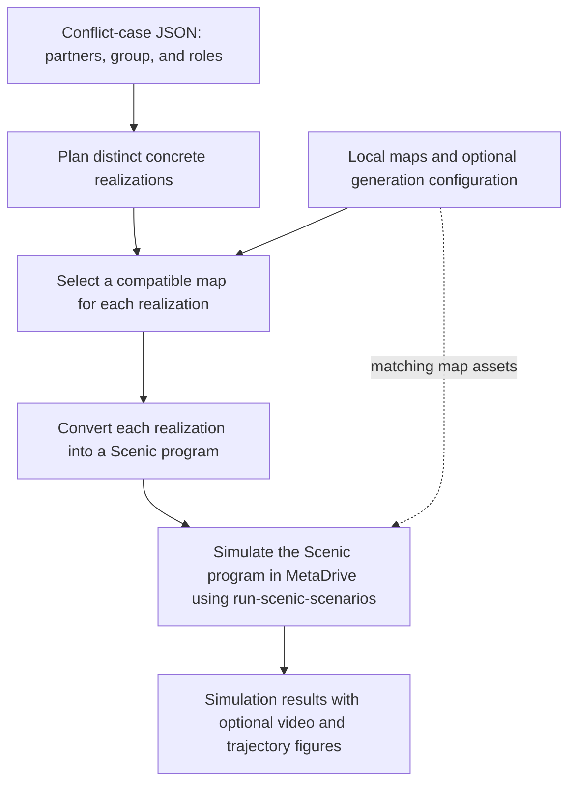

# Conflict2Scenic: Driving Scenario Generation from Conflict Typologies

To ensure robustness of autonomous driving systems, it is important to test them against a variety of challenging scenarios. However, creating such scenarios manually is time-consuming, while existing datasets often lack the diversity or complexity needed for thorough evaluation. This project addresses these challenges by generating scenarios from conflict typologies. A conflict typology is used to group conflicts that have common characteristics, such as the types of agents involved and their roles in the conflict. By leveraging these typologies, we can systematically generate a wide range of scenarios that cover different conflict cases.

Currently, we focus on a conflict typology proposed by Waymo[^1]. In the typology, conflicts are categorized based on 5 layers:
1. **Conflict partners**: The types of agents involved in the conflict (e.g., car, pedestrian, cyclist).
2. **Conflict group**: The high-level description of a conflict.
3. **Conflict perspective**: The sub-categorization of a conflict assigned to each partner.
4. **Conflict role**: The role of each partner in the conflict (either an initiator or a responder).
5. **Contributing factors**: The factors that contribute to the conflict, such as limited visibility, change in intent, etc.

In this project, we mainly focus on conflict partners, conflict groups, and conflict roles. Given a conflict case, we generate multiple diverse realizations of the conflict, each with different spatial arrangements or behaviors, while preserving the input partner types, roles, and conflict properties. The generated realizations are then converted into Scenic programs[^2], which can be used to simulate and test autonomous driving systems.

**Highlights**:
- **Automated Scenario Generation**: We develop a skill that automatically converts conflict cases into environment scenarios in Scenic, which can be used to test autonomous driving systems.
- **Diverse Realizations**: For each conflict case, our framework enumerates multiple realizations of the conflict, which can be used to test the robustness of autonomous driving systems against a variety of environmental conditions.
- **Extensibility**: Users can easily add new conflict cases by providing a JSON file that describes the conflict partners, group, and roles, hence the framework is extensible and can be transferred to other conflict typologies.
- **Automatic Map Selection**: We provide a feature to automatically select suitable maps for each realization.

[^1]: Kusano, K. D., Scanlon, J. M., Brännström, M., Engström, J., & Victor, T. (2023). "[Framework for a conflict typology including contributing factors for use in ADS safety evaluation](https://static.nhtsa.gov/esv/pdf/ESV/Proceedings/27/27ESV-000328.pdf)." In 27th International Technical Conference on the Enhanced Safety of Vehicles (ESV) National Highway Traffic Safety Administration (No. 23-0328, p. 3).

[^2]: Scenic is a probabilistic programming language for scenario modeling. See [Scenic website](https://scenic-lang.org/) for details.

## Table of Contents

- [Overview of the Project](#overview-of-the-project)
- [Installation](#installation)
- [Our Framework](#our-framework)
- [Conflict Cases and Scenic Scenarios](#conflict-cases-and-scenic-scenarios)
- [Creating a New Conflict Case](#creating-a-new-conflict-case)
- [Generating Scenic Scenarios from a Conflict Case](#generating-scenic-scenarios-from-a-conflict-case)
- [Running and Visualizing the Generated Scenic Scenarios](#running-and-visualizing-the-generated-scenic-scenarios)
- [Maps](#maps)

## Overview of the Project

The project connects conflict-case descriptions to concrete driving simulations. The [conflict-cases-to-scenic skill](#our-framework) plans distinct realizations, selects compatible maps, and writes matching JSON and Scenic files. The [scenario library](#conflict-cases-and-scenic-scenarios) provides examples organized by conflict group, with descriptions and visualizations in each case's folder. To simulate a generated program, use [run_scenic_scenarios.py](run_scenic_scenarios.py) through the [`run-scenic-scenarios` command](#running-and-visualizing-the-generated-scenic-scenarios), which runs MetaDrive and optionally exports video and trajectory figures.

## Installation

The project requires Python `>=3.8,<3.12`. From the repository root:

```bash
python -m venv .venv
source .venv/bin/activate
python -m pip install --upgrade pip
python -m pip install -e .
```

This installs Scenic with MetaDrive support, VerifAI, Matplotlib, Shapely, and the `run-scenic-scenarios` command. Install FFmpeg separately and make it available on `PATH` to export MP4 videos.

The repository's default generation prompt is configured for Codex and invokes the local skill. The skill consists of Markdown instructions and supporting references, so other LLMs or agents can follow the same workflow when given those files, the conflict-case input, and the map assets. Adapt the invocation to your chosen system and ensure it can read the project files and write the realization JSON and Scenic outputs.

## Our Framework



We develop a skill, [conflict-cases-to-scenic](.agents/skills/conflict-cases-to-scenic/SKILL.md), that automatically converts conflict cases into environment scenarios in Scenic. It first enumerates multiple realizations of the conflict, then selects a compatible map for each realization, and finally converts each realization into a Scenic program. The generated Scenic programs can be used to simulate and test autonomous driving systems.

The [input/output contract](.agents/skills/conflict-cases-to-scenic/references/conflict-case-contract.md) defines the expected input and output formats for the skill, ensuring consistency and compatibility with other components of the framework:
- **Input:** `conflict_group` with `title` and `property`, plus `conflict_partners` mapping IDs (including `ego`) to `type` and `role`.
- **Realization JSON:** `agents` with type, maneuver, relative position, and order; `road` with intersection and neighboring-lane flags; optional `ego` behavior and `comments`.
- **Scenic output:** a complete program for each realization, with a matching filename stem.

Map selection matches each realization's lane layout, travel directions, intersection movements, pedestrian space, and required clearances against the local assets. An explicit map takes precedence; otherwise the skill selects independently for each realization from maps with matching `.xodr` and `.net.xml` files, optionally restricted by `available_maps`. Map and model choices remain generation configuration, outside the realization JSON. The [map-selection reference](.agents/skills/conflict-cases-to-scenic/references/map-selection.md) records the inspected capabilities and selection rules. Selection uses static map inspection; compiling, sampling, and simulation happen later in the runner.

The [generation guide](.agents/skills/conflict-cases-to-scenic/references/scenic-generation-guide.md) covers map/model setup, placement, behaviors, and requirements. The [examples](.agents/skills/conflict-cases-to-scenic/references/examples.md) provide sample realizations and corresponding Scenic programs.

To simulate a generated program, use [run_scenic_scenarios.py](run_scenic_scenarios.py) through the [`run-scenic-scenarios` command](#running-and-visualizing-the-generated-scenic-scenarios), which runs MetaDrive and optionally exports video and trajectory figures.

## Conflict Cases and Scenic Scenarios

We include 14 conflict cases from the Waymo typology, each with multiple realizations, forming a library of [Scenic scenarios](scenarios/). In each case, the README describes the conflict and lists the generated scenarios, their initiators and responders, a description of the interaction, and links to Scenic programs and videos. Below is a summary of the conflict cases and their descriptions.

| Conflict case | Summary |
| --- | --- |
| [BACKING: Backing](scenarios/conflict_BACKING/README.md) | At least one road user reverses, creating an interaction with another vehicle or a pedestrian. |
| [F2R: Front To Rear](scenarios/conflict_F2R/README.md) | Road users share a lane and travel direction, with interactions caused by braking, stopping, acceleration, or a turn-related slowdown. |
| [ICT: Intersection Cross Traffic](scenarios/conflict_ICT/README.md) | Actors cross or change trafficways at an intersection along conflicting paths. |
| [ITIP: Intersection Turn Into Path](scenarios/conflict_ITIP/README.md) | An actor turns onto a trafficway into the path of an actor already using it. |
| [ODLI: Opposite Direction Lateral Incursion](scenarios/conflict_ODLI/README.md) | A non-turning actor traveling in the intended direction encounters an actor moving against that direction on the same trafficway. |
| [ODPC: Opposite Direction Prior Circumstances](scenarios/conflict_ODPC/README.md) | Actors initially travel in opposing trafficways before an evasive action, loss of control, or prior collision brings them into conflict. |
| [PDPC: Perpendicular Direction Prior Circumstances](scenarios/conflict_PDPC/README.md) | Actors on crossing roadways interact after an evasive action, loss of control, or prior collision. |
| [PED_CR: Pedestrian Crossing Road](scenarios/conflict_PED_CR/README.md) | A vehicle interacts with a pedestrian crossing its trafficway. |
| [PED_F: Pedestrian Forward](scenarios/conflict_PED_F/README.md) | A forward-moving vehicle interacts with a pedestrian standing in the trafficway or moving parallel to it without crossing. |
| [PED_IT: Pedestrian Interacting in Trafficway](scenarios/conflict_PED_IT/README.md) | A vehicle encounters a pedestrian moving around or interacting with an adjacent vehicle or object. |
| [SDLI: Same Direction Lateral Incursion](scenarios/conflict_SDLI/README.md) | Actors initially occupy different lanes of the same trafficway before one makes a lateral incursion. |
| [SDPC: Same Direction Prior Circumstances](scenarios/conflict_SDPC/README.md) | Actors traveling in the same direction interact following a lateral evasion, loss of control, or prior collision. |
| [SV: Single Vehicle](scenarios/conflict_SV/README.md) | Ego experiences an interaction within the trafficway or leaves it, without a conflict partner. |
| [TIPOD: Turn Into Path Opposite Direction](scenarios/conflict_TIPOD/README.md) | A turning actor enters another trafficway where an actor operates against the intended travel direction. |

## Creating a New Conflict Case

To create a new conflict case, add a folder `scenarios/conflict_<ID>` with a README describing the case and its realizations. Create `scenarios/conflict_<ID>/input.txt` containing JSON. Copy an existing case, such as [conflict_F2R/input.txt](scenarios/conflict_F2R/input.txt), and edit the group title/property and partner types/roles. Use `car` or `pedestrian` for the currently supported simulation workflow and `initiator` or `responder` for roles.

## Generating Scenic Scenarios from a Conflict Case

Edit [prompts/single_scenario.txt](prompts/single_scenario.txt) to point to your case, then run from the repository root:

```bash
codex exec "$(cat prompts/single_scenario.txt)"
```

The prompt selects the skill and asks it to choose a suitable map for each realization. Automatic candidates are maps with both `.xodr` and `.net.xml` files in `maps/`: Town01, Town04, Town05, Town07, and Town10HD. The [map-selection reference](.agents/skills/conflict-cases-to-scenic/references/map-selection.md) documents their inspected capabilities and the selection rules. Name an explicit map to override selection, or supply an `available_maps` list in the prompt or a separate generation-configuration JSON file to restrict automatic candidates. Paths in that configuration are relative to its directory; prompt paths default to the project root. Generated `localPath(...)` values are relative to the Scenic file, for example `../../../maps/Town04.xodr` for the standard output layout.

Outputs are stored in `scenarios/conflict_<ID>/realizations/*.json` and `scenarios/conflict_<ID>/scenic/*.scenic`. Each pair shares a stem: `<group>-<YYYYMMDDTHHMMSSZ>-<realization-id>`.

## Running and Visualizing the Generated Scenic Scenarios

From the repository root, pass one generated program to the runner:

```bash
run-scenic-scenarios scenarios/conflict_TIPOD/scenic/tipod-20261001T012059Z-left_turn_wrong_way_stop.scenic
```

The runner automatically reads the generated scene's `map` parameter and uses the matching `.net.xml` beside its `.xodr` file. For example, a program selecting `Town01.xodr` runs with `Town01.net.xml`; users do not need to supply map paths. Programs using `localPath(...)` resolve map paths relative to the Scenic file, independently of the command's working directory. Missing assets produce an error rather than a fallback to Town05.

The runner uses MetaDrive, records agent and lane polygons, and renders an MP4 video by default; static trajectory PNG output is disabled by default. Use `--video true|false` and `--png true|false` to control each format independently. For example, `--png true` enables both formats, `--video false --png true` saves only a PNG, and `--video false --png false` runs the simulation without rendering either format. The Python function `run_and_visualize_scenario` accepts matching `video=True` and `png=False` keyword arguments.

Enabled outputs are saved to `scenarios/conflict_<ID>/visualizations/<program-stem>.mp4` and `<program-stem>.png` from the same simulation. The video shows the simulation trajectory with agent footprints and the current occupied lanes.
The figure shows sampled agent footprints, centroid paths, start/end markers, and occupied lanes. It samples every 10 frames and always includes the final frame; use `--sample-interval 5` to change the spacing. Use `--save-path path/to/video.mp4` to choose another output location; when enabled, the PNG uses that path with a `.png` suffix, even if video output is disabled.

Optional map overrides are available on the CLI:

```bash
run-scenic-scenarios path/to/program.scenic \
    --xodr-map-path maps/Town04.xodr \
    --map-path maps/Town04.net.xml
```

`--xodr-map-path` overrides the map for both Scenic scene generation and MetaDrive simulation; without `--map-path`, its matching `.net.xml` is inferred. `--map-path` alone selects an alternative SUMO asset for the program's existing OpenDRIVE map. Override paths are relative to the command's working directory, and the supplied assets must describe the same road network. The Python functions `run_metadrive_scenario` and `run_and_visualize_scenario` retain the equivalent optional `map_path` and `xodr_map_path` arguments.

## Maps

The project includes a set of maps in the `maps/` folder. The maps are from the CARLA project, under the MIT license.
